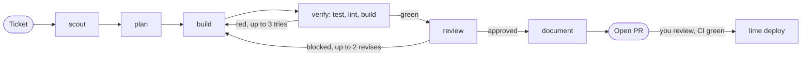

# lime

`lime` is a Python CLI that turns a markdown ticket into a reviewed pull request. A fixed pipeline runs AI agents (scout, planner, builder, reviewer, documenter) in their own git worktree, with tests, lint and git as plain code in between, and ends at an open PR that you merge with `lime deploy`.

## Quick start: your first Run

Heads up: there is no sandbox (agents run shell commands on your machine as you), and every Run spends real model quota.

**1. Get the tools.** You need Python 3.12+, [`uv`](https://docs.astral.sh/uv/), `git`, [`gh`](https://cli.github.com) and [Claude Code](https://claude.com/claude-code) with a Claude subscription. Log in to both CLIs:

```bash
gh auth login
claude            # sign in on first launch, then quit
```

**2. Install lime.** Install it exactly this way and keep the clone, because lime runs from it.

```bash
git clone https://github.com/JmCoding1304/lime-factory.git
cd lime-factory
uv tool install --editable .
```

**3. Set up your project.** Go to the root of the git repo you want lime to work on. Pick one you do not mind getting a PR on.

```bash
cd path/to/your-project
lime init
```

`lime init` asks four things, and Enter accepts each default:

- **Commands.** It proposes the `setup`, `test` and `lint` commands it detected. `test` is required, and `setup` must install dependencies, because every Run starts in a fresh worktree.
- **Logins.** Keep the default, "Claude subscription only". The mixed roster needs `pi`; see the [guide](docs/guide.md).
- **pi auto-compaction.** Say yes to turning it off. lime refuses to run otherwise.
- **Starter ticket.** Say yes and type a one-line title for the change you want.

**4. Commit and push.** `lime init` ends by printing the exact `git add`, `git commit` and `git push` lines for the files it created. Run them, because a Run starts from what `origin` has. If the repo has no GitHub `origin` yet, it prints the `gh repo create` line too.

**5. Fill in the ticket.** Open the starter ticket in `.lime/tickets/` and replace every TODO. Leave the file uncommitted. A finished ticket looks like this:

```markdown
# Add --limit flag to the list command
Workflow: feature
Status: open

## Ask
Add an optional `--limit N` flag to `list` that caps the rows printed. No flag means unchanged behaviour.

## Where
- `src/cli.py` - argument parsing and the list handler
- `tests/test_cli.py` - existing CLI tests

## Done means
- `list --limit 3` prints at most 3 rows.
- `list` without the flag prints every row.
- Tests cover both.

## Out of scope
- Pagination or offset flags (never)
```

`Workflow:` is `feature` or `bug-fix`. Put one backticked path per line under Where, and keep to six Done-means bullets.

**6. Run it.** N is the number at the start of the ticket's file name.

```bash
lime check        # validates the config, your logins and the ticket
lime run N        # takes minutes to hours; keep the terminal open
lime deploy N     # after you reviewed the PR on GitHub: merges it and cleans up
```

Watch a Run from a second terminal with `lime trace --follow`. Always merge with `lime deploy`, never by hand. If `lime check` complains only about `bun`, carry on: that is the optional dashboard.

## How it works



Scout, plan, build, review and document are headless agent Sessions (`claude -p` or `pi -p`). Everything else is Python. The plan is a list of Steps, and each Step must end with green tests before the next one starts.

- **Code owns the control flow.** Phase order, retries, test runs, commits, the push and the PR are Python. No agent decides what happens next.
- **Typed handoffs.** Each Role ends with one JSON Envelope. Code validates its schema, then checks its claims: the files it names exist or appear in the diff, and a review verdict agrees with its own findings. No conversation history crosses from one Phase to the next.
- **Write fences.** Each Role has a write boundary. A write outside it is rolled back and fails the Phase.
- **Bounded Sessions.** Each Session has token, wall-clock and repeated-call ceilings. An agent that hits one loses its tools and gets one chance to write a handoff note; the Phase then continues once in a fresh Session.
- **Mixed models.** Two runtimes sit behind one adapter, so each Role picks its own model. By default the reviewer is a different model family from the builder.
- **Full trace.** Every Phase, tool call, gate result and token count lands in SQLite and JSONL, readable with `lime trace`, `lime cost` and the `lime dash` web UI.

## Limits

- **There is no sandbox.** The only isolation is a git worktree and a branch.
- **There is no dollar cap**, only per-Session limits, so start with a small ticket. The default mixed roster bills a Claude subscription, a ChatGPT/Codex subscription and per-token OpenRouter for the builder; the Claude-only roster bills the Claude subscription alone.
- **Runs stay in the foreground.** Closing the terminal stops the Run.
- macOS and Linux only; developed on macOS.

## Commands

| Command | Use |
|---|---|
| `lime run N [N...] [--profile P]` | launch a Run per ticket; several run as a batch |
| `lime run --resume ID` | continue a failed Run in the same worktree and branch |
| `lime runs`, `lime runs rm ID` | list Runs; discard one |
| `lime trace [ID] [--follow \| --summary]` | Phases, gates and events of a Run |
| `lime cost [ID]` | spend by provider and Role |
| `lime status` | what needs you, across all registered projects |
| `lime deploy N` | merge the PR and clean up |
| `lime check [--profile P]` | validate config, models, credentials |
| `lime ticket next` | next free ticket number, for the tickets you write after the first |
| `lime dash` | web UI over the traces (needs `bun`) |

A failed Run keeps its worktree and branch, so `--resume` replays the Phases that succeeded and restarts the failed one.

From Claude Code: `lime init` also stamps a `lime` skill into the project. In a session there, ask in plain words or use `/lime`. It writes the ticket, asks you to ratify it and launches the Run.

## Read more

- [docs/guide.md](docs/guide.md): the operating guide. Rosters and cost, the first Run in full detail, failure handling, resume and recovery, sharp edges.
- [docs/architecture.md](docs/architecture.md): the design.
- [docs/customizing.md](docs/customizing.md): every knob, with file, keys and tests.
- [CONTEXT.md](CONTEXT.md) is the glossary; [docs/adr/](docs/adr/) holds the decision records.
