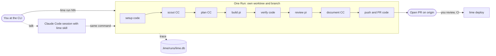
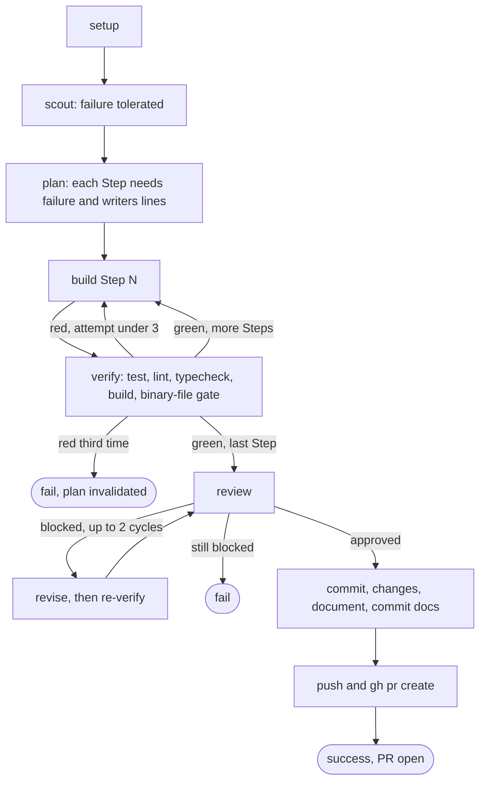
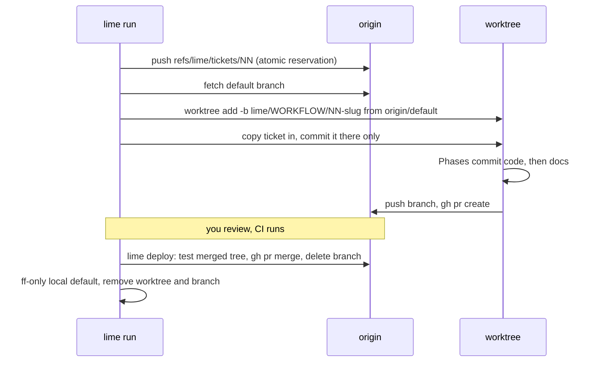

# lime

`lime` is a Python CLI that turns a markdown ticket into a reviewed pull request. A fixed, code-driven pipeline runs agent Roles (scout, planner, builder, reviewer, documenter) headlessly in a git worktree on its own branch; tests, lint and git steps in between are plain code, and the agents only propose. It ends at an open PR that you merge with `lime deploy`. It is not a sandbox (agent shell commands run on your host), not a hosted service, and not an IDE agent. Trying it costs real model usage per Run: the default roster bills a Claude subscription, a ChatGPT/Codex subscription and per-token OpenRouter for the builder; `--profile all-claude` bills the Claude subscription only. Runs take minutes to hours.

## Mental model



CC = Claude Code runtime (`claude -p`), pi = the pi coding agent runtime (`pi -p`). Roles in the default roster are split across the two; a profile can move any Role to either. The Orchestrator (an interactive session running the `lime` skill) is optional: everything it does is a CLI call you can make yourself.

**What runs where.** Everything runs on your machine as your user. `lime run` is one Python process per ticket (a multi-ticket launch adds a batch process and a watchdog). Code Phases (setup, verify, git, `gh`) are subprocesses of it. Each agent Session is a headless child, `claude -p` or `pi -p`, started in the Run's worktree and inheriting your full environment; its model calls leave over that CLI's own login. lime stores no credentials and only checks that they exist: Claude Code uses its own subscription login, pi holds the OpenRouter key and the Codex login, `gh` holds your GitHub token. Agent shell commands are not sandboxed. Trace events are scrubbed of credential-shaped strings, but each Session's `raw_output.jsonl` is not.

## Prerequisites

| Tool | Why | Needed |
|---|---|---|
| Python 3.12+, `uv` | install lime | required |
| `git`, a repo with a GitHub `origin` | worktrees, ledger refs, push (a dirty default branch only blocks the final fast-forward at deploy) | required for the full flow |
| `gh`, authenticated (`gh auth login`) | `lime ticket next` (reads PRs), `gh pr create`, `gh pr merge --merge` | required from ticket numbering on |
| `claude` (Claude Code CLI), logged in to a subscription | scout, planner, documenter, and `lime check` always probes it | required |
| `pi` (npm `@earendil-works/pi-coding-agent`) plus Node | builder and reviewer in the default roster | required unless `--profile all-claude` |
| OpenRouter key in pi, ChatGPT/Codex login in pi | default builder (`openrouter`) and reviewer (`openai-codex`) | default roster only |
| `bun` | `lime dash`; `lime check` reports its absence as FAIL | optional for Runs |

## Install

lime must be installed editable from a clone. A wheel or `git+url` install omits `guard/` (the pi Guard extension) and `dashboard/`, which sit outside the `lime/` package. Agent Sessions call `lime guard` and `lime hook budget` by name, so `lime` must stay on `PATH`.

```bash
git clone <repo-url> limefactory && cd limefactory
uv tool install --editable .
lime --help
```

`lime run` and `lime check` also refuse to start unless pi's settings turn auto-compaction off, even when no Role uses pi. The code reads `~/.pi/agent/settings.json` and requires `compaction.enabled` to be exactly `false`. `lime init` offers to set it on a terminal; to do it by hand, merge the key, do not overwrite the file (the error reads `pi compaction is on`):

```bash
python3 -c 'import json,pathlib as P;p=P.Path.home()/".pi/agent/settings.json";p.parent.mkdir(parents=True,exist_ok=True);s=json.loads(p.read_text()) if p.exists() else {};s.setdefault("compaction",{})["enabled"]=False;p.write_text(json.dumps(s,indent=2))'
```

## Choose a roster

(a) **Claude subscription only:** pass `--profile all-claude` to `lime check` and `lime run`. No pi, no OpenRouter, no Codex. (b) **Default mixed roster:** needs the Claude subscription, an OpenRouter key and a ChatGPT/Codex login, both of the latter held by pi (`lime check` runs `pi auth check --provider <p> --json` and wants `ready`).

| Role | Default: runtime, model, bills | `all-claude`: runtime, model |
|---|---|---|
| scout | claude_code, claude-haiku-5-5, Claude sub | same |
| planner | claude_code, claude-opus-5-5[1m], thinking xhigh, Claude sub | same |
| builder | pi, openrouter/deepseek/deepseek-v4.1-flash, thinking high, OpenRouter cash | claude_code, sonnet |
| reviewer | pi, openai-codex/gpt-6-astra, thinking high, Codex sub | claude_code, fable |
| documenter | claude_code, claude-haiku-5-5, thinking high, Claude sub | same |
| researcher, designer | on demand only (`lime research`, `lime prototype`), not part of a Run | sonnet, opus |

What your plans must expose: the planner needs a model with a 1M window (`[1m]`; the bare id clamps to 200k) and `xhigh` effort; the reviewer should be a different model family from the builder (a design choice, not enforced); every pi model id must exist in pi's catalog with the configured thinking level (`lime check` fails otherwise); the `deploy` session pins `claude-fable-5[1m]` but only runs if `deploy:` is non-empty. Claude model ids are checked only for shape (`haiku`, `sonnet`, `opus`, `fable` or `claude-*`), not for availability on your plan. Edit `.lime/config.yaml` to substitute models. The roster is frozen into the Run at launch.

**Cost.** Each Session bills where its Role's runtime bills (table above). In the default roster only the builder is pay-per-token cash (OpenRouter); the Claude and Codex Roles draw on your subscriptions. The code has no dollar cap: the limits are per Session (tokens, wall clock) and per Phase (3 build attempts per Step, 2 revise cycles, 1 Continuation, 1 gate correction, 1 fresh Session after stream errors), so a Run's cost scales with its Step count and retries. `lime cost [run-id]` reads the trace (default: last 7 days) and prints spend by provider and by Role; `claude_code` figures are notional API-rate equivalents, not charges. This repo contains no measured per-Run price, so measure on a small ticket first.

## First Run

Use a repo you do not mind getting a PR on. It needs a GitHub `origin`, and `gh` auth from step 4 on. Work from the repository root: lime does not support a project in a subdirectory of a repo, and `lime init` there warns.

1. In the target repo, `lime init`. On a terminal it then asks a few questions in this order: stack commands (detected from `package.json`, `pyproject.toml` or a Makefile), which logins you have, pi compaction (only if it is on), a starter ticket (only inside a git repo, and only when it just created `config.yaml`). Answering "Claude subscription only" rewrites the roster to all-Claude, so later you need no `--profile`. Ctrl-C at any question exits 130 and prints how to finish by hand. `lime init --no-input`, or no terminal, skips the questions. It stamps `.lime/config.yaml` and `.lime/trust.yaml` (only if absent), `.lime/{maps,tickets,specs,prompts}/`, `.gitignore` entries, `.claude/skills/lime/`, a budget hook in `.claude/settings.json`, and registers the project in `~/.lime/projects`. The wizard ends by printing the next steps, including the exact `git add` / `git commit` line for the files it stamped (never the ticket), `gh repo create` if there is no `origin`, and the push. Do that first: a Run branches from `origin/<default>`, so unpushed commits are invisible to it, and a ticket committed but not pushed makes `lime run` refuse.
2. Edit `.lime/config.yaml` (the wizard already filled `commands:` and emptied `deploy:` if it created the file). The stamped file is a template for another stack (`pnpm`, `createdb`, `vercel`). Replace `commands.setup/test/lint/typecheck/build/teardown`; `commands.test` is required, other keys are skipped if absent. If the wizard found no test command it writes a placeholder that `lime check` and `lime run` refuse. Set `deploy: []`. Leave `runs.ports` (3100-3102 is the parallel-Run cap; each Run gets one as `$LIME_PORT`). `setup` runs in the fresh worktree, so it must install dependencies:
   ```yaml
   commands:
     setup: npm ci            # also available: $LIME_RUN_ID, $LIME_PORT, $LIME_DB_NAME
     test: npm test
     lint: npm run lint       # optional; so are typecheck, build, teardown
     test_timeout: 600        # optional, whole seconds
   deploy: []
   ```
3. `lime check --profile all-claude` (no flag for the default roster, or if the wizard already set all-Claude). It prints the resolved roster; `warn ... ls has no Claude Code tool` lines are harmless. Expect FAIL lines only for real problems; see Sharp edges for what `check` over-reports. A starter ticket from the wizard makes it red until you fill the ticket in (step 5).
4. `lime ticket next` prints the next free number N (derived from git: origin branches, PRs, reservations, local files).
5. Write `.lime/tickets/N-<slug>.md`, **leave it uncommitted**. `lime run N` matches the number whatever its zero padding; if two ticket files share a number it refuses and asks you to name one in full (`lime run 01-a`).
   ```markdown
   # Add --limit flag to the list command
   Workflow: feature
   Status: open

   ## Ask
   Add an optional `--limit N` flag to `list` that caps the rows printed. No flag means unchanged behaviour.

   ## Where
   - `src/cli.py` - argument parsing and the list handler
   - `tests/test_cli.py` - existing CLI tests

   ## Done means
   - `list --limit 3` prints at most 3 rows.
   - `list` without the flag prints every row.
   - `--limit 0` or a negative value exits non-zero with a usage error.
   - Tests cover all three.

   ## Out of scope
   - Pagination or offset flags (never)
   ```
   `Workflow:` is `feature` or `bug-fix` in practice (`greenfield` and `front-end` also lint). One backticked path per line under Where, or the launch is refused. Keep to six Done-means bullets and under 80 lines (`check` fails longer files). The wizard's starter ticket has `TODO` text and a `CHANGE-ME/...` Where line without backticks: `lime check` is red and `lime run` refuses it until you replace them.
6. `lime run N --profile all-claude` (no flag for the default roster, or if the wizard already set all-Claude). It runs for minutes to hours in the foreground: keep the terminal open, because closing it stops the Run. From an agent harness, use its background mode.
7. In a second terminal, `lime trace --follow` (latest Run) or `lime trace --summary`. On failure see State, resume and recovery below.
8. Review the PR on GitHub. Deploy refuses while CI is red or pending; no checks at all counts as green.
9. `lime deploy N` runs setup and tests on the merged tree (a docs-only merge conflict is settled by lime), merges the PR (`gh pr merge --merge`), deletes the remote branch, fast-forwards your local default branch, removes the worktree and marks the Run `deployed`.

## What a Run does



Phases are `engineer` (records the ask), `setup`, `scout`, `plan`, `build` and `verify` per Step, `review` with `revise`, then `commit`, `changes`, `document`, `commit_docs`, `push_pr` (`lime/workflows/feature.py`). Approval with a non-empty `trust_violations` counts as blocked. `bug-fix` is the same chain with a reproduce-first planner and reviewer prompt.

## When an agent stalls, loops, overruns or returns garbage

Per Session, all in `lime/agents.py` and `lime/budget.py`; each limit has a constant listed in [docs/customizing.md](docs/customizing.md) section 6, and the state machine is in [docs/architecture.md](docs/architecture.md) section 5.

| Situation | What the code does |
|---|---|
| Stalls past `timeout_s` (default 1800 s) | Latches the stop (Guard denies everything but handoff writes), sends one nudge with a 300 s window: write a handoff note and report `success` only if every requirement is met, else `partial`. No report in the window fails the Phase. |
| Same tool call with identical arguments 3 times in a row | Handled exactly like the time ceiling. |
| Context reaches 150k tokens / 250k | Warn (wrap up) / stop latches for the Session, Guard closes substantive tools. The Spine kills the process at the model's window minus 20k if the agent keeps burning tokens. Window sizes for Claude Code are estimates (200k, 1M for `[1m]`). |
| `partial` Envelope | One Continuation: a fresh Session seeded with the handoff note and git facts. A second partial ends the Run as `budget_exhausted` when both were measured ceilings, else fails the Phase with `blocked: <notes>`. |
| Malformed or schema-invalid Envelope | Up to 2 correction turns in the same Session (on pi a rejected `submit` is relayed as the correction), then the Phase fails. |
| False claim (missing artifact or changed file, verdict contradicting findings) | Gate violations go back once as a correction (a fresh Session on pi, whose Session ends at an accepted `submit`), then the Phase fails. |
| Write outside its `writes` or into a protected file | Reverted by the phase-end check and the Phase fails with `PermissionBreach`. |
| Transient stream error (pi Roles only) | Retried in place twice (15 s, 30 s), then one fresh Session, then fail. A Claude Code Role never gets this ladder; its stream error fails the Phase. |
| Agent reports `fail`, or a Phase raises | The Phase and the Run end `fail` (a failed scout is the one exception: the planner is told why and the Run goes on). Nothing else is retried; the worktree and branch are kept. |

## State, resume and recovery

| State | Where |
|---|---|
| Trace | `.lime/runs/lime.db` (SQLite mirror, gitignored) and `.lime/runs/<run-id>/events.jsonl` (source of truth); `run.json` freezes the roster at launch |
| Per Session | `.lime/runs/<run-id>/` holds the exact prompts sent and `raw_output.jsonl`; Phase handoff files (`scout_findings.md`, `plan.md`, `changes.diff`, handoff notes) sit in its `context_handoff/` |
| Code and PR | the worktree `~/.lime/worktrees/<project>/<run-id>` on branch `lime/<workflow>/<NN>-<slug>`, then the branch and PR on origin |
| Ticket numbers | refs on origin, never deleted: `refs/lime/tickets/<NN>`, `refs/lime/adr/<NNNN>` |
| Registry | `~/.lime/projects` (what `lime status` and `lime dash` read) |

Run ids are per project; run every command from the project root. A Run's status is `running`, `success`, `fail`, `budget_exhausted`, `deployed` or `discarded`.

**Resume.** `lime run --resume <run-id>` works on a `fail` or `budget_exhausted` Run (or a `running` one whose process died), as long as its worktree and the uncommitted ticket file in `.lime/tickets/` still exist. It re-enters the same worktree, branch and roster (`--profile` is ignored: to change models, discard and start fresh), replays every succeeded Phase from the trace and restarts the failed one in a fresh Session; the latest `verify` re-runs against the current tree. It refuses a resume that would do nothing, and refuses a plan whose ticket, planner prompt or resolved limits changed: use `--replan` after editing the ticket, or `--rereview` when only review kept blocking. A Run whose branch was rebased or merged past its pinned base fails loud: discard it and start fresh.

**Discard.** `lime runs rm <run-id>` runs `commands.teardown`, removes the worktree and the local and pushed branch, and marks the Run `discarded`; the Trace stays. Save any diff you want first.

## The contract between Phases: the Envelope

Roles do not hand each other free-form output. Every agent Phase ends with one typed JSON Envelope that the code parses (pydantic, `lime/data_types.py`) and checks before the chain moves on. The only other channels are files in the Run's `context_handoff/` directory (findings, plan, diff, handoff notes) and the git state of the worktree; no conversation history crosses from one Phase to the next.

| Role | Envelope fields beyond `status`, `summary`, `artifacts`, `notes_for_next_agent` |
|---|---|
| scout | `findings` (file, note); also writes a findings file |
| planner | none; writes `plan.md` with one `## Step N` section per builder Session, each carrying `failure:` and `writers:` lines |
| builder | `changed_files`, `commit_message` |
| reviewer | `approved`, `findings` (requirement, met, evidence), `blocking`, `trust_violations` |
| documenter | `changed_docs`, `adrs`, `commit_message` |

`status` is `success`, `fail` or `partial`. Delivery differs per runtime: pi Roles call a `submit` tool whose parameters are the JSON Schema of the type (rejected calls are relayed as a correction); Claude Code Roles end with a JSON object in the final text. Code Phases (`verify`, `changes`) emit the same shape, so a failing test run reaches the builder through the same door as an agent report.

After parsing, claim gates run: the artifacts exist; the plan has `failure:`/`writers:` per Step; `changed_files` exist or appear in the diff against the Run's pinned base; the review's verdict agrees with its own blocking items, unmet requirements and trust violations; claimed docs exist and new `CONTEXT.md` entries fit 350 characters. A failed gate sends the violations back as a correction, once; a second failure fails the Phase. Then the write-fence check runs, and only then is the Envelope accepted. A `partial` Envelope and a reported `fail` are handled as in the table above.

## Enforced by code vs asked of the prompt

| Enforced in code | Only asked in the prompt (and checked by the reviewer) |
|---|---|
| Phase order, retry and attempt limits, exit status | secrets the agent must not read or write (`secrets`) |
| `verify` commands; red goes back to the builder; 3 reds fail the Run | branches it must not push to or check out (`branches`) |
| Envelope shape and the claim gates above | commands it must not run (`commands`) |
| `protected_files` and each Role's `writes`: snapshot, diff, rollback, `PermissionBreach`; `writes` also denied at call time by the Guard for native `write`/`edit` (a `bash` write is only caught by the phase-end diff) | style, scope and plan fidelity beyond what the gates test |
| Context warn and stop, time ceiling, 3-identical-calls stop | |
| ticket numbering, branch naming, push, PR, merge, fast-forward | |

There is no sandbox: shell commands from the builder run as you, in the worktree. The trust lists in the right column are a prompt block, not a denylist. The Guard fails open on its own internal errors, and the phase-end check then still rolls back.

## Git model



## Commands

| Command | Use |
|---|---|
| `lime run N [N...] [--profile P]` | launch a Run per ticket; several tickets run as a batch capped by `runs.ports`, honoring `Blocked by:` |
| `lime run --resume ID [--replan \| --rereview]` | continue a failed Run |
| `lime runs [--all]`, `lime runs rm ID` | list Runs; discard one (worktree, branch, work) |
| `lime trace [ID] [--follow \| --summary]` | phases, gates, events of a Run |
| `lime cost [ID]` | spend by provider and Role (Claude figures are notional) |
| `lime status` | report over all registered projects: needs you, failed, ready to deploy |
| `lime deploy N`, `lime deploy --check` | merge the PR and clean up (N required); `--check` fetches origin and changes nothing |
| `lime check [--profile P]` | validate config, models, credentials; print the resolved roster |
| `lime ticket next` | next free ticket number |
| `lime dash [--port P]` | web UI over the traces (needs `bun`); API 4600 (`--port` moves it), UI 4601 |

Also: `lime scout "<q>"`, `lime research "<q>"` and `lime prototype <slug> "<ask>" [--continue | --lock]` run one on-demand Session; `lime profiles`, `lime models`, `lime focus` and `lime ticket close|reopen` serve the dashboard and the Orchestrator. `lime batch`, `lime hook budget` and `lime guard` are internal plumbing.

## Driving it from Claude Code

`lime init` stamps `.claude/skills/lime/` into the project. In a Claude Code session there, ask in plain words ("add a --limit flag to list") or use `/lime`. The skill acts as Orchestrator: it routes a request to a ticket plus `lime run`, to `/lime map` (foggy or greenfield work), `lime prototype`, `lime research` or `lime scout`; it reads status and traces; it never does a Role's work. It will ask you to ratify a ticket before launching. `/lime install` runs an attended onboarding that also rewrites AGENTS.md and CONTEXT.md; skip it on first contact.

## Sharp edges

- A red `lime check` is stricter than a refused launch: `lime run` gates only on config validation, the pi catalog, credentials and the compaction setting. Check also always requires `gh`, `bun` and a live `claude` haiku probe whatever the roster, and those failures do not stop a launch.
- The stamped `config.yaml` is not generic. Left alone, `setup` runs `createdb`, and `lime deploy` would start a Claude session to run `vercel deploy --prod`.
- Launch refuses (exit 2) when `## Where` names no path or two paths on a line, or when a path overlaps another unmerged Run's branch (`--allow-overlap` for one fresh ticket).
- `AGENTS.md` over 60 lines fails check and launch; a `CONTEXT.md` entry over 350 characters fails check. The documenter writes only `AGENTS.md`, `CONTEXT.md` and `docs/adr/`, and they land in your PR.
- `.lime/trust.yaml`, `.lime/config.yaml` and `.claude/skills/lime/` are protected: agent writes there are reverted and abort the Phase. Secrets, branches and forbidden commands are held by prompt and the reviewer, not by code. There is no sandbox.
- Merge only with `lime deploy`. A hand merge leaves no deploy record and later deploys refuse.
- Closing the terminal stops the Run, and so does a foreground shell with a ~10 minute timeout (exit 143), as some agent harnesses have: keep the terminal open, or use the harness's background mode.
- `ANTHROPIC_API_KEY` in the environment makes Claude Code bill the API instead of the subscription; `check` warns.
- `lime dash` binds 127.0.0.1; the UI port 4601 is fixed, only the API port moves (`--port`). macOS and Linux only; developed on macOS (the Claude credential check also looks in the macOS Keychain).

## Changing things

| To change | Edit (section numbers are in docs/customizing.md) | Takes effect |
|---|---|---|
| a Role's model, runtime, thinking, tools, write boundary, timeout | `agents:` / `defaults:` in `.lime/config.yaml` (customizing section 1) | next Run (a Run keeps its launch roster) |
| a named variant of the roster | `profiles:` in the same file; `--profile NAME` (only runtime, model, thinking, `timeout_s`, `tool_choice` can differ) | next Run |
| a Role's prompt | `lime/prompts/<role>/{system,user}.md` in the clone for everyone, or an explicit `prompt_engineering` path per Role in the project config (section 4) | next Run |
| test/lint/build commands, ports, deploy lines | `commands:`, `runs:`, `deploy:` (section 2) | next Run |
| what no Run may touch | `.lime/trust.yaml` (section 3) | next Phase |
| Phase order, a new Phase, a new workflow | `lime/workflows/feature.py` and `phases.py` (section 5) | next command; the clone is an editable install |
| token, time, retry limits | constants in `lime/budget.py`, `agents.py`, `data_types.py` (section 6) | next command |
| the Guard, a runtime adapter, the skill | `_cmd_guard` in `lime/cli.py`, `agent_pi.py` / `agent_cc.py`, `lime/skill/lime/` then `lime init` per project (sections 7, 8, 10) | next command |

Read next: [docs/customizing.md](docs/customizing.md) (every knob, with file, keys and tests), [docs/architecture.md](docs/architecture.md) (the design), [CONTEXT.md](CONTEXT.md) (glossary), [docs/adr/](docs/adr/) (decision records).
