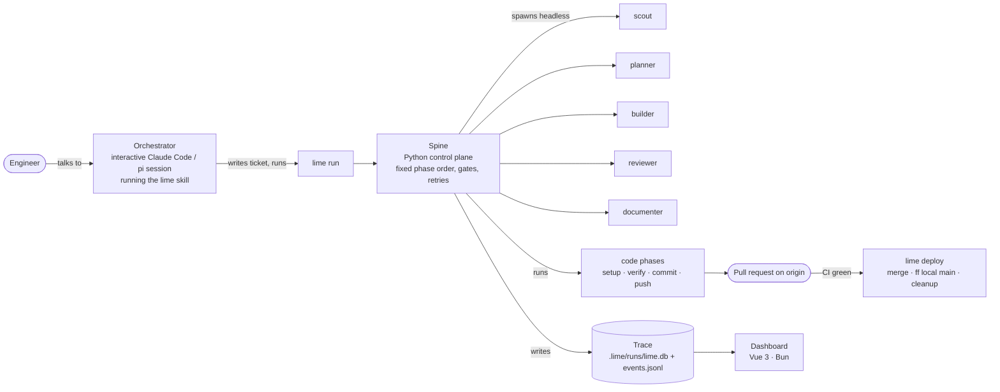
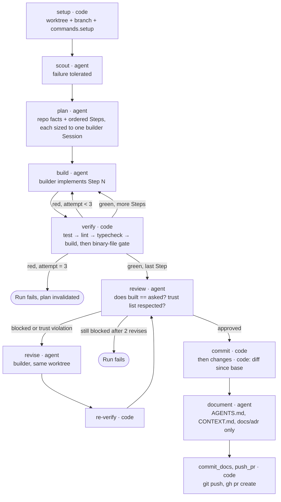
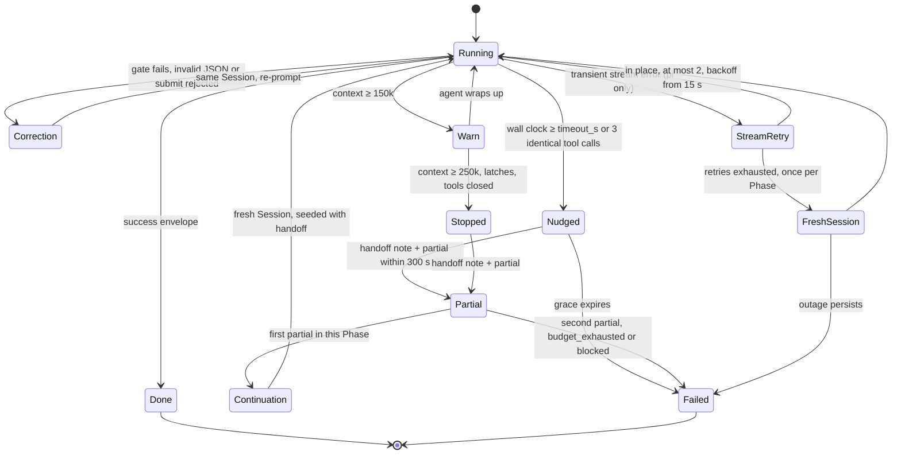
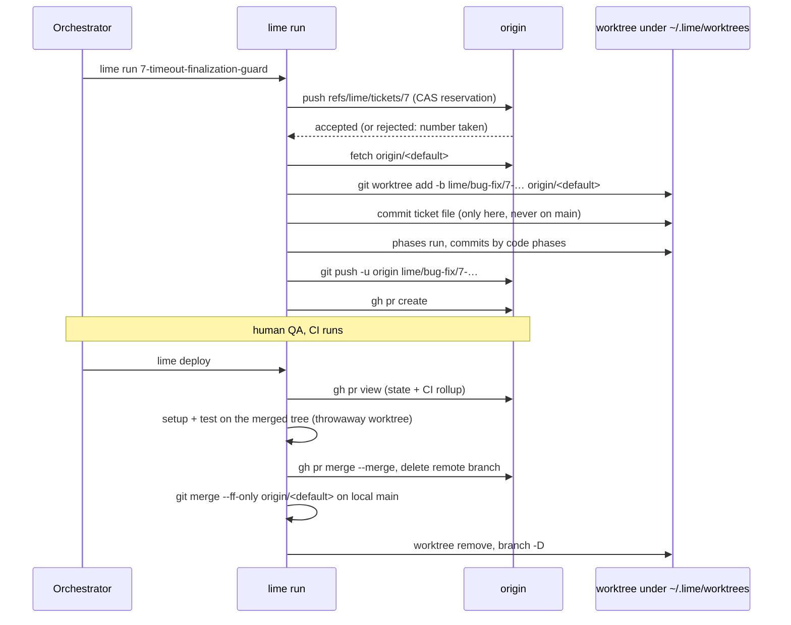
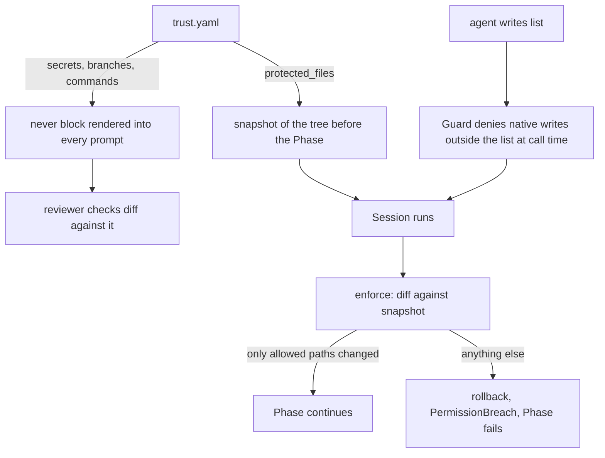
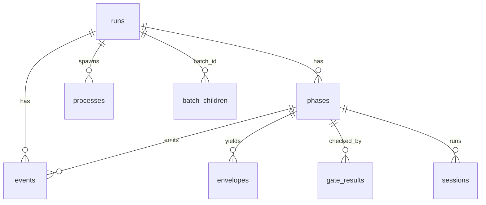
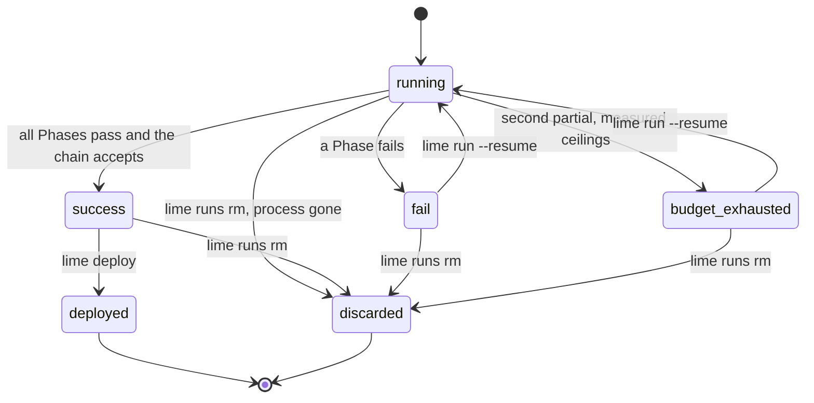

# lime: architecture

Install and first-Run instructions are in the top-level [README](../README.md); this document is the design.

A small software factory: a ticket goes in, a reviewed pull request comes out, and no human is in the loop between the two.

`lime` is a Python CLI that runs a fixed, deterministic pipeline of steps. Some steps are LLM agents (scout, plan, build, review, document). The others are plain code (git, tests, lint, gates). The agents propose; the code disposes. Every Run happens in its own git worktree on its own branch, is traced to SQLite and JSONL, and ends by opening a PR that a human merges with `lime deploy`.

Design choices: the factory ships once as an installed tool instead of being copied into every project (ADR 0001); two agent runtimes sit behind one adapter signature; and Roles exchange typed envelopes whose claims are checked by code-enforced gates.

---

## 1. The idea in one picture



Three layers, three trust levels:

| Layer | What it is | Who decides |
|---|---|---|
| **Upstream** | The engineer and the Orchestrator: mapping, grilling a plan, prototyping, locking a spec, writing the ticket. | Human |
| **Run** | The Spine executing one Workflow against one ticket. Headless. No human inside. | Code (phase order, gates) with agents proposing |
| **Downstream** | QA of the PR branch and `lime deploy`. | Human |

## 2. Vocabulary

The repo keeps a full glossary in [`CONTEXT.md`](../CONTEXT.md). The terms you need to read this document:

| Term | Meaning |
|---|---|
| **Target project** | A codebase the factory is installed into and operates on. limefactory is its own first target. |
| **Workflow / Chain** | A named end-to-end procedure (feature, bug-fix) and the ordered list of Phases that implements it. |
| **Phase** | One step of a Chain. Kind `engineer` (human input), `agent` (a Role runs once), or `code` (deterministic: tests, git). |
| **Role** | A named agent job with its own prompt, model, tools and write boundary. Seven are configured: scout, researcher, planner, builder, reviewer, documenter, designer (an eighth, `summarizer`, is built in for `lime focus summarize` and is not in the roster). |
| **Runtime** | The program that runs an agent loop. Two exist: `pi` and `claude_code`. Each Role is bound to one. |
| **Session** | One Role's context window, spawn to exit. One agent Phase is one Session. |
| **Envelope** | The typed JSON a Role must return. The Spine parses it with pydantic and checks its claims. |
| **Gate** | A code check on an Envelope's claims. A failed Gate sends the violations back as a correction in the same Session (on pi, whose Session ends at an accepted `submit`, in a fresh one that carries the accepted report). It never restarts the Phase. |
| **Fence** | A code-enforced write limit. Violations are rolled back, not re-prompted. |
| **Run** | One execution of one Workflow, identified by a run id. Owns a worktree, a branch, and a Trace. |
| **Trace** | The recorded timeline of a Run: phases, tool calls, gate results, tokens, cost. JSONL is truth, SQLite is the query mirror. |
| **Profile** | A named patch of runtime, model and thinking per Role, layered over the roster at Run start. |

## 3. Anatomy of a Run

The feature Chain (`lime/workflows/feature.py`). Bug-fix is the same Chain with plan and review prompt addenda that ask for one reproduce-and-fix step (`lime/workflows/bug_fix.py`). Before `setup` the Chain records an `engineer` Phase (the ask); it is left out of the diagram.



A red re-verify after a revise is fed back to the revise loop as a blocking item and uses up one of the two revises. The diff lands in `context_handoff/changes.diff` under the Run's directory.

What each agent Phase must hand back:

- **scout** → `ScoutOutput`. Writes `scout_findings.md`: paths and notes, never file contents, at most ~20 lines. The planner folds these in. Nothing else in the repo documents code structure.
- **plan** → `PlanOutput`. Writes `plan.md` with one `## Step N` section per builder Session, naming files, change and tests. It is the only thing the builder reads.
- **build** → `BuildOutput`. Files changed, claims about tests.
- **review** → `ReviewOutput`. `approved` must be consistent with its own blocking findings, unmet requirements, and trust violations. The gate checks that consistency.
- **document** → `DocumentOutput`. May touch only the three doc files (see the Doc standard, section 9).

Two invariants the reader should hold on to:

1. **Every Step ends green** (ADR 0005). A Step is one builder Session plus one verify. Verify runs the target project's own `commands:` in order and hands the first failure back to the builder as a correction. Three reds on one Step fail the Run. There are no "write the failing test first" steps.
2. **Gates re-prompt, Fences roll back.** A wrong claim in an Envelope costs a correction turn in the same Session. A write outside the Role's boundary or into a protected file is reverted by `lime/permissions.py` and raises `PermissionBreach`, because the damage already happened and prompting cannot undo it.

## 4. The living parts

### 4.1 The roster

Defined in `.lime/config.yaml` of the target project, stamped from `lime/templates/config.yaml`. Defaults at time of writing:

| Role | Job | Runtime | Model | Thinking | May write | Tools |
|---|---|---|---|---|---|---|
| scout | Find and report where things live. | claude_code | Haiku 5.5 (claude-haiku-5-5) on the subscription | medium | nothing | read, grep, find, ls, bash, write |
| researcher | Bring outside knowledge back as a short brief. On demand only. | claude_code | sonnet | low | nothing | read, grep, find, ls, bash, write, web, context7 docs tool |
| planner | Turn a ticket into a plan the builder needs no questions for. | claude_code | Opus 5.5 (claude-opus-5-5[1m]) on the Claude subscription | xhigh | nothing | read, grep, find, bash, write, subagent (no ls, no edit) |
| builder | Implement one Step. | pi | deepseek-v4.1-flash via OpenRouter | high | anything not fenced | read, grep, find, ls, bash, edit, write |
| reviewer | Confirm built equals asked. | pi | GPT-6 Astra (openai-codex/gpt-6-astra) on the Codex subscription | high | nothing | read, grep, find, ls, write |
| documenter | Update AGENTS.md, CONTEXT.md, docs/adr. | claude_code | Haiku 5.5 (claude-haiku-5-5) on the subscription | high | those three paths | read, grep, find, ls, bash, write, edit |
| designer | Produce two or three clickable prototype variants. Upstream only. | pi | kimi-k3 (openrouter/moonshotai/kimi-k3) via OpenRouter | medium | `**/proto-<slug>/**` | read, grep, find, ls, bash, edit, write |

"Nothing" means `writes: []`. The agent's `write` tool still exists so it can produce its findings file in the handoff directory, but any write into the repo is rolled back.

Testing is a code Phase, never a Role. Researcher and designer are never fixed Phases; the Orchestrator invokes them on demand through `lime research` and `lime prototype`. The planner's `subagent` tool maps to pi child sessions (`subagents.ts`) on pi and to Claude Code's `Agent` tool on claude_code; neither spawns roster Roles.

### 4.2 Config and profiles

`.lime/config.yaml` top-level keys:

| Key | Holds |
|---|---|
| `defaults` | Roster-wide fallback for runtime, model, thinking, tools, harness extensions. |
| `agents` | The roster above. |
| `profiles` | Named patches of `runtime`, `model`, `thinking`, `timeout_s`, `tool_choice` per Role. Nothing else: a profile can never change a Role's tools, write boundary or prompt. Template ships `quality`, `all-claude`, `api-research`. |
| `commands` | The target project's own `setup`, `test`, `lint`, `typecheck`, `build`, `teardown` shell lines, plus optional `test_timeout` seconds. Absent keys are skipped. |
| `deploy` | Ordered shell lines the deploy session runs after merge. Empty means skip. |
| `budget` | Warn and stop token ceilings per Session. Default 150k / 250k. |
| `runs` | `ports` (the parallel-Run cap). |
| `commit` | `exclude`, `uncounted` and `max_added_lines` (1500): staging exclusions and the sizing budget, measured and never a stop. |
| `auto_deploy` | `off`, `staging` or `prod`: what an unattended `lime run ... --deploy` batch merge ships to. |

Merge order for one Role is `defaults ← agent entry ← profile patch`. `lime run --profile quality` layers that patch (in the template, a stronger builder model) over the roster for one Run without touching anything else. A per-Role `tools:` list replaces the defaults; it does not extend them. `lime check --profile P` prints the resolved roster and validates every model against the runtime's catalog.

### 4.3 Two runtimes, one adapter signature

| | `pi` | `claude_code` |
|---|---|---|
| Binary | `pi -p --mode json` (the pi coding agent, npm `@earendil-works/pi-coding-agent`) | `claude -p --output-format stream-json` |
| Bills | Whatever provider account pi holds: OpenRouter and xAI by API, `openai-codex/*` on the ChatGPT plan. | The Claude subscription. `ANTHROPIC_API_KEY` in the environment triggers a warning because it would silently switch billing to the API. |
| Model id shape | `provider/model`, e.g. `openrouter/deepseek/deepseek-v4.1-flash`. `anthropic/*` is rejected on pi by design. | `haiku`, `sonnet`, `opus`, `fable`, or a `claude-*` id. |
| Envelope delivery | A `submit` tool whose parameter schema is the Role's pydantic JSON Schema. pi validates the call before the tool runs, so the envelope arrives as a dict, never as text (ADR 0007). | Fenced JSON in the final text, parsed by the Spine. |
| Mid-flight hook (Guard) | `tool_call` extension (`guard/guard.ts`). | `PreToolUse` hook wired through `--settings`. |
| Tool restriction | `--tools` allowlist per Role. | `--tools` allowlist per Role. |

`lime/agent_pi.py` and `lime/agent_cc.py` have the same signature: spawn one Session, turn its JSON stream into an `AgentResult` (text, usage, context size, status). The Spine never sees a runtime flag.

### 4.4 Prompts and harness code

- **Prompt engineering** lives in `lime/prompts/<role>/system.md` and `user.md`, the package default every Role resolves. A target project overrides a Role by naming explicit `prompt_engineering` `system:`/`user:` paths (usually under `.lime/prompts/`) in `.lime/config.yaml`; a configured path that is missing fails `lime check` and the Run rather than falling back to the package default. Every user prompt receives `{{prompt}}` (the ticket), `{{previous_envelope}}` (the correction context), `{{context_handoff_dir}}`, `{{report}}` (the Envelope contract, generated per runtime), `{{never}}` (the trust file's secrets, branches and forbidden commands) and `{{rules}}` (the project's AGENTS.md, or CLAUDE.md fallback, plus the sorted `docs/adr/` filename index). The exact rendered prompt is saved next to the Session's trace.
- **Harness engineering** lives in `lime/harness_engineering/*.ts`: pi extensions that register tools. `submit.ts` (envelope delivery), `scout.ts` (a `scout` tool that shells out to `lime scout`, so the Orchestrator never reads target source itself, ADR 0014), `subagents.ts` (headless child sessions for the planner), `context7.ts` (library docs lookup for the researcher).

### 4.5 The Orchestrator and the `lime` skill

The Orchestrator is the engineer's own interactive session running the skill in `lime/skill/lime/`. `lime init` stamps it into the target project's `.claude/skills/lime/`. Its rules, in brief:

- It routes and reports. It never does a Role's work and never edits a Run's worktree.
- A well-scoped build or fix becomes a ticket and `lime run`. A foggy or greenfield ask becomes `/lime map` (a wayfinder map that ends in a locked spec). A UI ask becomes `lime prototype`. An external question becomes `lime research`. A repo question becomes `lime scout`.
- A ticket is the four-line prompt: `## Ask`, `## Where`, `## Done means`, `## Out of scope`. More than six `Done means` bullets forces a split into tickets chained by `Blocked by:`.
- Ticket numbers come from `lime ticket next`, never from counting files.
- Deploy refusals (PR not open, CI red) are reported and stopped on. Never hand-merge with `gh pr merge`; that leaves no deploy Run behind.

Example ticket (abridged):

```markdown
# Enforce finalization-only tools at the Session time ceiling

Workflow: bug-fix
Status: open

## Ask
Prevent the builder from continuing implementation after a time-ceiling nudge ...

## Where
- `lime/agents.py` — shared Session execution, timeout nudge, budget latching.
- `tests/test_agents.py` — focused regressions only.

## Done means
- On the first `timeout_s` expiry, the stop latch is visible to the Guard before the nudge is sent.
- During the grace period, new substantive tool calls are denied ...

## Out of scope
- Any redesign of the Continuation path.
```

## 5. The control plane: what keeps a Session honest



- **Budget** (`lime/budget.py`). Measures context occupancy, meaning input plus cache reads and writes, never output. Warn at 150k tells the agent to wrap up. Stop at `min(250k, window - 40k)` closes substantive tools through the Guard. Once a Session reaches stop it stays stopped even if a later measurement reads lower (ADR 0015). If the agent keeps spending anyway, the Spine kills the process at `window - 20k` and the Phase fails. Every warn is treated as a sign the plan Step was too big.
- **Time ceiling** (`timeout_s`, default 1800 s per Role). One deadline armed at Session start; retries never extend it. At the ceiling the Spine sends exactly one nudge under a 300 s timer: write a handoff note and submit `success` only if every requirement is met, else `partial`. Never a silent kill (ADR 0011).
- **Continuation.** A `partial` envelope buys one fresh Session for the same Phase, seeded with the previous envelope, the handoff note and git facts. A second partial ends the Run.
- **Stream retry** (ADR 0008, 0009). pi Roles only: `agent_cc.py` never reports a stream `error`, so a Claude Code stream failure fails the Phase at once (a resume restarts it). Transient provider stream errors on pi are retried in place up to twice with doubling backoff, then once more in a brand-new Session with a context-preserving prompt. That allowance is independent of Continuation. A further outage fails the Phase.
- **Malformed Envelope.** Unparseable or schema-invalid output gets up to `JSON_FIX_ATTEMPTS` (2) correction turns, then the Phase fails. On pi a reply that leaks a tool call as text instead of calling it is recovered once in a fresh Session (ADR 0016).
- **Submit rejection.** On pi, a `submit` call that fails JSON Schema validation is relayed verbatim as a correction. It does not count as a Guard denial.
- **Attempt exhaustion** (ADR 0003). When a Step burns all build attempts, the plan Phase and everything after it are marked invalidated in the trace, so `--resume` re-plans instead of replaying a cached plan.

## 6. The git model



- **Worktrees live outside the repo**, under `~/.lime/worktrees/`. All edits and test runs happen there. The Trace outlives the worktree.
- **The ticket is carried into the worktree, not committed on the default branch** (ADR 0004). Committing it on local `main` first put `main` ahead of `origin/main`, and the later fast-forward broke.
- **Ticket numbering is a git ledger** (ADR 0006, `lime/numbering.py`). `next_number()` is `max + 1` over four sources: local ticket files, `ticket:` commit subjects on any branch, origin branch names and reservation refs, and PR head refs via `gh`. Tickets are deleted on close, so counting files would re-issue numbers. `reserve()` pushes a throwaway commit to `refs/lime/tickets/<NN>` on origin before any worktree exists. Ref creation is atomic on the server, so a second Run racing on the same number gets a push rejection. Reservations are never deleted. Gaps in the sequence are expected.
- **Deploy** (ADR 0002, 0029). It refuses unless the PR is open and CI is green (no checks counts as green), runs setup and test on the merged tree in a throwaway worktree, and only then merges. Merge happens server-side through `gh`. The local default branch is then fast-forwarded with `--ff-only`. On divergence it warns and never resets, stashes or forces.
- **Branches are one-shot.** Teardown force-deletes the local branch and the remote branch if one was pushed. `gh pr merge --delete-branch` is deliberately not used: it fails while any worktree still has the branch checked out.

### The trust file

`.lime/trust.yaml`, per target project, four lists:

| List | Example | Enforced by |
|---|---|---|
| `protected_files` | `.lime/trust.yaml`, `.lime/config.yaml`, `.claude/skills/lime/` | Code. Before-and-after snapshot of the tree in `lime/permissions.py`; offending paths are reverted and the Session breaches. A Role's own `writes:` allowlist can unlock a protected path on purpose. |
| `secrets` | `.env`, `**/*.pem`, `**/credentials*` | Prompt (`{{never}}` block) and the reviewer's diff check. |
| `branches` | `main`, `master` | Same. |
| `commands` | `git push --force`, `git reset --hard`, `rm -rf` | Same. There is no command denylist hook by design. |



In a shared-tree session (prototype, research) a Ledger of the paths the agent's own tool calls named is used, so an engineer's concurrent edits are never attributed to the agent.

## 7. Observability

- **Tracer** (`lime/tracer.py`). Nine SQLite tables at `.lime/runs/lime.db`, in WAL mode. Twenty-one event types: phase and agent start/end, tool_call, tool_result, handoff, gate pass/fail, log, error, budget warn/stop/kill, continuation, turn, crash_detected, timeout nudge/kill, repeat_stop, refusal. Every event is also appended to `.lime/runs/<run_id>/events.jsonl`, which is the source of truth. Each Session gets a directory with the exact prompts sent and the raw output stream.



`runs` carries status, ticket, branch, worktree, port, db name, profile, `base_sha`, PR number and url, `batch_id` and `kind`; there are no foreign-key constraints, only shared ids; `phases` the ordered Phase rows with status and attempt; `events` the typed event stream; `envelopes` each Role's report as JSON; `gate_results` each gate's checks; `sessions` one row per Role context window (model, window, budget); `processes` the live pids and heartbeats. `batch_children` and `summaries` serve batches and the status report.



A resume replays every Phase that succeeded and was not invalidated, then restarts the failed one. `--replan` invalidates from `plan`; `--rereview` from the last verify before the first review. A `running` Run whose process is gone is also resumable.

- **Resume.** `lime run --resume <run_id>` replays every phase that succeeded and was not invalidated, from the trace, and refuses a resume that would do zero work. `--replan` re-plans against an edited ticket; `--rereview` reopens a Run whose review kept blocking. The roster is replayed from the trace too, so `--profile` is ignored on resume.
- **Cost.** One `turn` event per model answer, so spend is visible while a Phase is still running. The dashboard records two figures per Session: `api_cost` (what was billed) and `notional_cost` (what a subscription Session would have cost at API rates). The Cost tab of the Settings modal shows them side by side.
- **Dashboard** (`dashboard/`). Vue 3, Vite, Bun, TypeScript. `lime dash` starts a JSON API on port 4600 over every project registered in `~/.lime/projects`, plus the Vite dev UI on 4601. It opens every `lime.db` read-only and has a server-sent-events live feed. The workspace page (Home) has a project file tree, an Editor whose Run tabs show a Run canvas over a read-only Terminal, and a Focus tab; a Runs sheet, a Notch of running Runs and a Settings modal (Cost, Profiles, Appearance) sit on top. Its writes are confined to registered project roots: profile edits shell out to `lime profiles set` or `lime profiles merge`, and file saves, renames and trash go through the file API; the server itself never writes a database or runs git; the home repo is written only by `lime` commands it spawns (`lime dash visit`, tick). It binds 127.0.0.1 only.

## 8. Install and CLI

See the top-level [README](../README.md) for prerequisites, install and a first Run.

All CLI commands:

| Command | Does |
|---|---|
| `init [--no-input]` | Stamp `.lime/` and the skill into a project; on a terminal a setup wizard follows (stack commands, roster, pi compaction, starter ticket) and prints the next steps. Re-running refreshes only factory-owned files. |
| `check [--profile P]` | Validate config and print the resolved roster. |
| `run <ticket...> [--profile P] [--resume RUN_ID [--replan \| --rereview]] [--allow-overlap] [--deploy]` | Launch one Run per ticket. Several tickets run as a batch, capped by `runs.ports`. |
| `runs [--all]`, `runs rm <id>` | List or discard Runs. |
| `trace [id] [--follow \| --summary]` | Phase table, gates, events. |
| `cost [id]` | Spend by provider and Role. |
| `status [--project P] [--json] [--no-gh]` | Read-only report over every registered project: needs you, failed, ready to deploy. |
| `dash [--port P]` | Dashboard over every registered project (`--port` moves the API; the UI stays on 4601). |
| `deploy <ticket>`, `deploy --check` | Test the merged tree, merge the PR, fast-forward local default, tear down, run `deploy:` lines. `--check` fetches origin and changes nothing. |
| `ticket next` | Next free ticket number (`close` and `reopen` set a ticket's `Status:`, owner-only). |
| `scout <question>`, `research <question>` | On-demand scout or researcher Session. |
| `prototype <slug>` | Designer loop: start, continue, lock. |
| `focus` | The goal list in the `lime dash` home repo (`~/.lime/dashboard/`). |
| `profiles`, `models` | Read or patch the `agents:`/`profiles:` blocks; print pi's model catalog. |
| `batch`, `hook budget`, `guard` | Internal: the batch watchdog, the Orchestrator budget hook and the per-tool-call Guard. |

## 9. Repo layout and doc philosophy

```
lime/                 the CLI package (lime.cli:main)
  agents.py           Session execution: prompts, corrections, budget, timeouts, retries
  runner.py           runs a Chain, owns exit status
  workflows/          feature.py, bug_fix.py, phases.py (the Phase library)
  agent_pi.py         adapter: pi runtime
  agent_cc.py         adapter: Claude Code runtime
  gates.py            envelope claim checks
  quality.py          runs the target's commands: block
  permissions.py      write fences and rollback
  budget.py           context ceilings
  worktree.py, git_helper.py, numbering.py, changes.py
  tracer.py           SQLite + JSONL trace
  tracker.py          ticket file parsing
  prompts/            per-Role system.md + user.md
  harness_engineering/ pi extensions (.ts): submit, scout, subagents, context7
  skill/lime/         the Orchestrator skill, stamped into targets
  templates/          config.yaml and trust.yaml stamped by lime init
guard/                pi Guard extension (budget messenger)
dashboard/            Vue 3 + Vite + Bun SPA (server/, src/, shared/)
tests/                pytest, one file per lime/ module
docs/adr/             decision records, one file each
CONTEXT.md            the glossary
```

The Doc standard, enforced by the documenter Role's write boundary: a target project keeps `AGENTS.md` (target ≤40 lines, `lime check` fails above 60; points at config and trust file), `CONTEXT.md` (glossary) and `docs/adr/`. Anything else must be readable from code or it is deleted. Tickets are deleted on close. Prototypes are deleted when their Run documents itself.

## 10. Decisions you may want to argue with

The first fifteen of the records in [`docs/adr/`](adr/):

| ADR | Decision |
|---|---|
| 0001 | Factory code lives once, as the installed `lime` tool. Only config, the trust file and the skill are copied into a target. |
| 0002 | After `gh pr merge`, fast-forward the local default branch. Warn on divergence, never force. |
| 0003 | Attempt exhaustion logs a `phase_invalidated` event rather than mutating append-only phase rows. |
| 0004 | The ticket travels in the worktree, never committed on the default branch. |
| 0005 | No "failing test first" Steps: the plan prompt bans them, so the code-enforced build/verify loop can require every Step to end green. |
| 0006 | Git is the ticket-numbering ledger. A reservation ref on origin is the lock. |
| 0007 | pi Roles deliver envelopes through a schema-validated `submit` tool. |
| 0008 | Transient stream errors retry in place, same Session, with backoff. |
| 0009 | Then once in a fresh Session. Then fail. |
| 0010 | `$ref`/`$defs` in the submit schema are inlined; some providers mishandle references. |
| 0011 | Time ceiling: one nudge for a handoff and a partial, never a silent kill. |
| 0012 | Python owns the per-model thinking-support table; the dashboard reads it over the API. |
| 0013 | pi's own model catalog is the dashboard's whole model vocabulary. |
| 0014 | The Orchestrator is harness-agnostic: the skill is the contract, scouts and research come from the roster. |
| 0015 | Budget stop latches per Session. |

## 11. Honest limits

- **No sandbox.** Isolation is a git worktree and a branch. The builder's shell commands run on the host. `lime/worktree.py` is the single point a remote sandbox would replace.
- **`gh` is load-bearing.** Without an authenticated `gh`, numbering, PR creation and deploy all fail loudly.
- **Real branch deletion.** Every teardown runs `git branch -D` and deletes the pushed remote branch. Fence rollback runs `git checkout -- <path>` on tracked files. Both are scoped and intentional.
- **Claude Code's context window is a guess** (200k, or 1M for `[1m]` aliases), because the real number only appears in the stream's final event.
- **Parallel Runs are separate processes**, one per ticket, capped by `runs.ports`. There is no scheduler.
- **Prompt-only fences.** Secrets, branches and forbidden commands are held by prompt and reviewer, not code. Only `protected_files` and each Role's write boundary are code-enforced.
